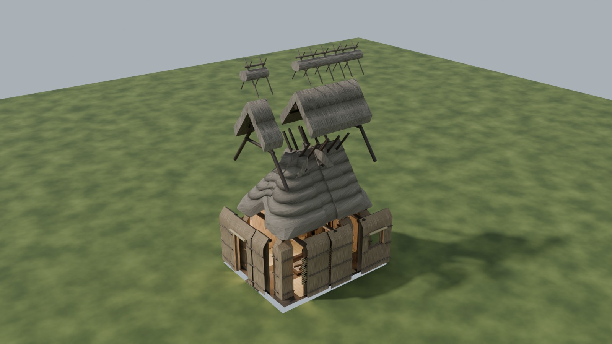
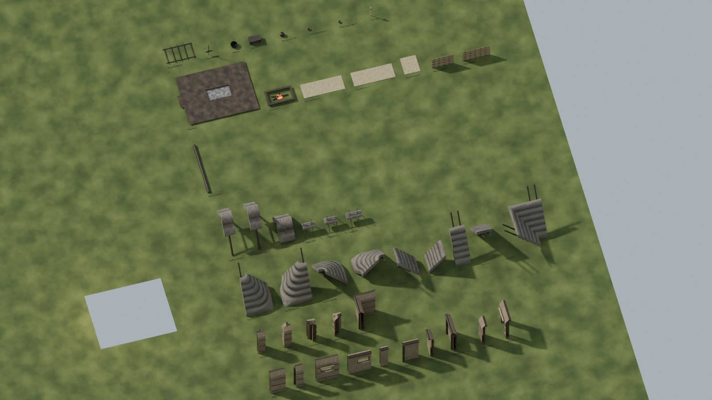
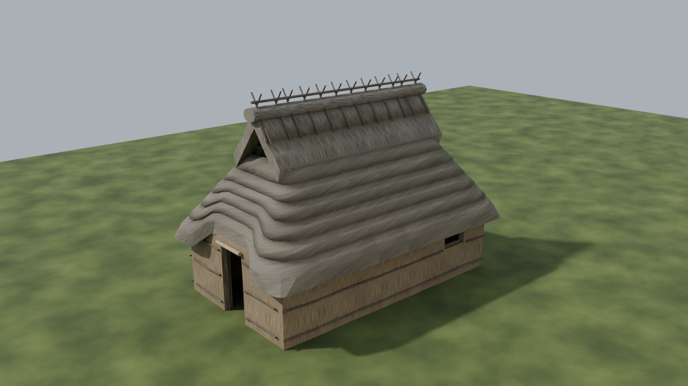

# Ainu chise modular kit

`ainu_chise_kit.py` takes the Ainu chise from `ainu_chise.py` / `ainu_chise.blend`
and splits it into separate meshes for building game worlds. You get wall
segments, corners, window and door walls, roof pieces for every side and corner
(including a valley), the upper smoke-gable roof, the ridge, structural timber
and every interior prop. Each piece has a pivot on a shared floor grid.



## Run it

Headless, from this folder (Blender 5.0):

```bash
blender --background ainu_chise.blend --python ainu_chise_kit.py -- --export out/ainu_chise_kit.glb --export-dir out/kit --manifest out/kit_manifest.json --save out/ainu_chise_kit.blend
```

| option | what it does |
|---|---|
| `--export file.glb` / `.fbx` | all kit pieces in one file, one node per piece |
| `--export-dir dir [--format fbx]` | one file per piece, with the pivot at the file origin |
| `--manifest file.json` | name, layer, bounds, tris and materials per piece |
| `--render-parts / --render-kit / --render-demo file.png` | Cycles previews (exploded house / kit layout / longer demo house) |
| `--save file.blend` | saves a copy of the scene with the kit collections |
| `--samples n` | Cycles samples for the previews (default 16) |

Interactive: open `ainu_chise.blend`, load `ainu_chise_kit.py` in the Scripting
workspace and click **Run Script**. Re-running only replaces the script's own
collections. If the house isn't in the scene (for example with
`--factory-startup`), the kit script runs `ainu_chise.py` first to build it.

## What you get

| collection | contents |
|---|---|
| `AinuChise_Parts` | all 54 pieces of the house in place (`PT_<type>_NN`), so the house is re-assembled from parts |
| `AinuChise_Kit` | the 46 unique piece types (`SM_AinuChise_<type>`), sharing mesh data with the parts. Exported. |
| `AinuChise_KitPreview` | labels, and a demo house 2 m longer built from linked kit pieces. Never exported. |

The source meshes stay in `AinuChise_LOD0`, hidden and unchanged.



### Piece list

| group | pieces |
|---|---|
| walls | `Wall_S_1m`, `Wall_S_0.5m`, `Wall_S_Window_1.5m`, `Wall_N_1m`, `Wall_N_0.5m`, `Wall_N_Window_1.5m`, `Wall_E_0.75m`, `Wall_E_Window_1.5m`, `Wall_W_0.75m`, `Wall_W_Door_1.5m` |
| corners | `Wall_Corner_SE/SW/NE/NW` (outer), `Wall_Corner_Inner` (concave, synthetic) |
| roof (hip skirt) | `Roof_S_1m`, `Roof_N_1m`, `Roof_Corner_SE/SW/NE/NW`, `Roof_End_E`, `Roof_End_W_Door` (door eave notch), `Roof_Valley` (concave, synthetic) |
| upper roof | `RoofTop_1m`, `RoofTop_Gable_E/W` (smoke gable with vent, A-frame, collar) |
| ridge | `Ridge_1m`, `Ridge_End_E/W` |
| frame | `Frame_TieBeam` |
| props | `Prop_Floor` (with the hearth pit), `Prop_Hearth`, `Prop_Mat_Floor_N/S/E`, `Prop_Hanging_N/S`, `Prop_Drying_Rack`, `Prop_Pot_Hanger`, `Prop_Pot`, `Prop_Treasure_Shelf`, `Prop_Lacquer_Tub`, `Prop_Lacquer_Bowl_A/B`, `Prop_Inau` |

The kit totals about 10.9k tris. The run prints a table with tris, material count and size for every piece.

The interior timber travels with the shell piece it sits in:

- posts and wall plates go with the walls
- rafters, hip rafters and purlin rings go with the roof skirt
- A-frames, upper purlins and the ridge pole go with the upper roof

So every piece also looks right from inside, and a longer house brings its frame with it.

## Grid and pivots

Z is up, units are metres, and pieces keep their world orientation (names carry the
facing). **Every pivot is on z = 0:**

| piece | pivot |
|---|---|
| wall and roof-skirt runs | outer wall line, at the start of the piece (min x for S/N, min y for E/W) |
| corners (wall and roof) | outer wall corner, e.g. (2.5, -2.0, 0) for SE |
| hip ends | outer wall line, middle of the end wall |
| upper roof and ridge | ridge centreline, at the start of the piece (ends: at the x = ±1 join) |
| synthetic inner corner / valley | the concave outer-wall corner |
| props and beams | bottom centre (rack and pot hanger: top centre) |

A 1 m wall straight and a 1 m roof straight with the same pivot stack exactly. To
make a longer house, insert `Wall_S_1m`, `Wall_N_1m`, `Roof_S_1m`, `Roof_N_1m`,
`RoofTop_1m` and `Ridge_1m` at x = 0 and move the east half along. That's what
the demo does:



## How it cuts

- **Layers.** Each mesh island is classified as wall, roof skirt, upper roof, ridge,
  tie beam or prop by its material, height and position. Real dimensions come from
  `ainu_chise.py`'s `Geo`, with mesh measurement as a fallback.
- **Regions.** Each piece is a plan-view box (`wall_cuts`, `wall_corner`,
  `roof_cuts`, `roof_end_half` in `CONFIG`). Wall cuts are checked against the
  generator's openings, so a cut can never split a window or the door.
- **Cut or keep whole.** Long continuous parts (thatch, binding poles, wall plates,
  purlin rings, ridge pole) are cut with `bisect_plane` and the cut is capped.
  Assembled details (window and door frames, crossed ridge sticks, blinds, vents,
  posts, rafters, A-frames) stay whole and go to the piece that holds their centre.
- **Seams.** The source thatch has about 2 cm of outward jitter, so ends cut at different x
  would not match. Every modular cut end is snapped, loop by loop, onto one
  reference cross-section. The seam vertices then get custom normals from the
  continuous surface (the source's own normals at the reference cut), so any
  straight meets any other straight, corner or end with no step and no shading
  crease.
- **Normals.** `ainu_chise.py` stores the rolled thatch shading as custom split
  normals. `Source.load` copies them per corner into a bmesh loop layer. Cuts
  interpolate them, welds and mitres average them per vertex, and caps stay flat.
  `to_mesh` writes them back with `normals_split_custom_set`, and seam vertices
  override them with the seam normal. Kit pieces in Cycles, in the viewport and
  exported to glTF/FBX shade the same as the source house. If the source has no
  custom normals (a `.blend` saved by an older `ainu_chise.py`), the script warns;
  rebuild the house first. The run checks this: *worst end-to-end mismatch
  0.0 mm* over all 14 straights.
- **Ridge sticks** are re-spaced to 0.25 m / 0.75 m in every 1 m ridge module, so a
  row of modules keeps an even rhythm. This is why ridge area is +4.5% compared with the source.
- **Synthetic concave pieces.** Copies of `Wall_S_1m` / `Roof_S_1m` are laid end to
  end, mitred at 45° through the outer wall corner and mirrored. Both slopes of the
  valley use the side pitch (52°).
- **Faces** are quads and tris only (n-gons from cutting are triangulated), so FBX
  exports with tangents and no warnings.
- **Checks printed every run:** area coverage per layer (source vs pieces), any
  unassigned or duplicated islands, unmatched seam vertices, and the tiling check.

## Adapting it

- Different openings or footprint in `ainu_chise.py`: edit `CONFIG["wall_cuts"]` so
  every opening fits inside one segment (the script tells you which cut is wrong).
- Different module length: `CONFIG["roof_cuts"]`. The wall cuts need a cut at the
  same x if you want to insert modules there.
- Props are matched by material plus a centre box (`PROPS`). Islands that match
  nothing end up in `Prop_Misc` and are reported, so no geometry is lost.

## Known limitations

- No per-piece collision (`UCX_`) or LODs yet. The house-level ones from
  `ainu_chise.py` still exist in the source collections.
- Valley and inner-corner pieces exist only for the roof skirt and the walls. A T-
  or L-junction of the upper smoke-gable roof would need its own valley piece.
- Procedural materials don't export (same as `ainu_chise.py`). Pieces carry
  world-scale UVs and material slot names, ready for baked or engine materials.
