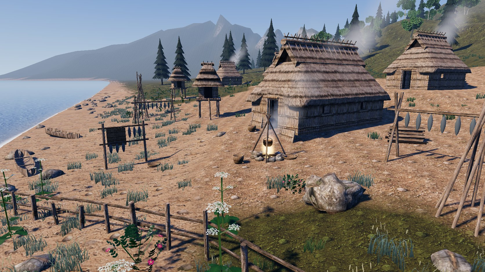
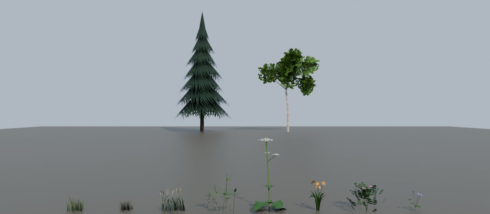

# Ainu coastal village + Rishiri flora

`ainu_village_scene.py` builds the coastal kotan from the concept art out of the chise kit
(`ainu_chise_kit.py`), and exports a folder that you can drop into Godot 4. `ainu_flora.py`
paints a foliage atlas in code, models eight Rishiri / Hokkaido plants and two native trees, and
scatters them over the village and its hills. The village script runs it automatically.



## Run it

Headless, from this folder (Blender 5.0). The village needs the atlas textures folder
`ainu_atlas_derived_PBR_4K`, either next to the repo or given with `--tex-src`:

```bash
blender --background --factory-startup --python ainu_village_scene.py -- --godot-dir out/godot/ainu_village --export-prefabs --render out/village.png --save out/ainu_village.blend
```

| option | what it does |
|---|---|
| `--godot-dir dir` | glTF, textures, shaders, materials, import script and main scene for Godot |
| `--godot-res-dir res://path` | where that folder lives in the Godot project (default `res://ainu_village`) |
| `--export-prefabs` | also one `.gltf` per prefab (houses, pu, racks, boats, rocks, every plant) |
| `--tex-src dir` / `--tex-res n` / `--force-textures` | atlas folder, game texture size (2048), rebuild textures |
| `--no-flora` | skip grass and plants |
| `--interiors` | 5 m houses keep the kit's interior props |
| `--render file.png` / `--samples n` / `--save file.blend` | Cycles render from the concept camera, save the scene |

Plants on their own (atlas, a lineup render and `flora_species.gltf`):

```bash
blender --background --factory-startup --python ainu_flora.py -- --out out/flora --render out/flora.png
```

Godot: copy `out/godot/ainu_village` to `res://ainu_village`, then open `ainu_village_main.tscn`.
The generated `README_Godot.md` lists every file.

## The village

- **Houses:** five variants composed from the kit's wall and roof pieces (`HOUSES` in the script).
  Each variant is merged into one mesh, and every copy shares it.

  | prefab | length | S wall run | N wall run | tris |
  |---|---|---|---|---:|
  | `Chise_4m` | 4 m | 1-1-1 | 1-0.5-1-0.5 | 8.6k |
  | `Chise_5m` | 5 m | 1-1-0.5-W | W-0.5-1-1 | 10.2k |
  | `Chise_6m` | 6 m | 1-W-1-0.5-1 | 1-1-1-1-1 | 11.5k |
  | `Chise_7m` | 7 m | 1-1-0.5-W-1-1 | W-0.5-1-1-1-1 | 12.9k |
  | `Chise_8m` | 8 m | 1-W-1-1-W-1 | 1-1-W-0.5-1-1-1 | 14.4k |

  - **Ends:** the corners, end walls (W door, E sacred window), hip ends, smoke gables and ridge
    ends move out by half the extra length.
  - **Straights:** 1 m roof, upper-roof and ridge straights fill the middle.
  - **Wall runs:** each S/N run is built from 1 m, 0.5 m and 1.5 m window (`W`) wall pieces.
    The script checks that every run exactly fills the gap between the corners.
  - **Tie beams:** spaced about every 1.4 m.
  - **Width:** stays at the kit's 4 m, because the kit has no width modules.
- **Thatch UVs:** re-projected on the houses and pu. U runs along the eave and V up the slope, from
  the height. The kit's loft UVs (arc length per ring) shear the thatch on the hips and smear it
  along the upper roof; with the new mapping the `thatch_reed` courses stay level all round the roof.
- **Props:** pu storehouses, fish racks, a fire pit (with the kit's pot), firewood, baskets, lean-to
  poles, screens, dugout boats, rocks and a fence.
- **Layout:** placed from the concept's framing (place across the frame plus distance from the camera).
- **Terrain:** one mesh with sinh-spaced cells, about 1.5 m in the village and growing out to the
  mountains. A 4-layer splat (sand, earth, grass, rock) is stored in COLOR_0.
- **Godot:** the import script puts splat, water and foliage shaders on the terrain, sea and
  plants. Smoke and fire markers become particles. Godot builds mesh LODs and applies visibility
  ranges. Colliders use the `-col` / `-convcolonly` import hints.
- **Atlas fixes:** the source swatches are cropped to remove bleed from their neighbours and made
  tileable again. The normals are boosted. AO, roughness and metallic are packed into one ORM map.
  The swatches named `weathered_timber` and `woven_reed` are swapped (reed wall and timber); the
  output textures are named for what they show.

## Flora



| prefab | plant | tris | grows |
|---|---|---:|---|
| `Grass_Meadow` | O-nogariyasu meadow grass (*Calamagrostis langsdorffii*) | 12 | grass, thinning onto earth and away from the village |
| `Grass_Flowers` | meadow grass with buttercups | 12 | patches in the meadow |
| `Leymus_Mollis` | Hama-ninniku, beach wild rye | 12 | upper beach / dune line |
| `Sasa_Kurilensis` | Chishima-zasa dwarf bamboo | 108 | thickets on the slopes past the village edge |
| `Heracleum_Lanatum` | O-hanaudo cow parsnip, the white umbels in the concept | 102 | meadow rims, along the fence |
| `Hemerocallis_Esculenta` | Ezo-kanzo day lily | 40 | coastal meadow patches |
| `Rosa_Rugosa` | Hamanasu beach rose | 124 | dune and meadow edge |
| `Geranium_Erianthum` | Chishima-furo wild geranium | 44 | meadow patches |
| `Picea_Jezoensis` | Ezo-matsu, Ezo spruce | 142 | forest patches on the lower hills, 55 m+ from the village |
| `Betula_Ermanii` | Dake-kanba, Erman's birch | 210 | stands on the slopes, 50 m+ from the village |

- **Trees:** low poly.
  - The spruce is a tapered trunk inside seven cone tiers. A painted needle texture with a ragged,
    drooping lower edge gives the tiers their branch tips.
  - The birch has a leaning, tapered trunk with pale peeling bark, three limbs and crossed
    leaf-cluster cards.
- **Atlas:** painted with numpy at 2048 px: BaseColor with alpha, Normal (OpenGL +Y) and ORM. The
  transparent texels are filled with nearby colour, so alpha-clipped mipmaps get no dark fringes.
- **Materials:** two of them, `M_FoliageGrass` and `M_Foliage`, both glTF `MASK` at 0.45 and
  double-sided. Grass cards have up-facing normals so they light like the ground.
- **Chunks:** grass and plants go into 16 m chunks (`Flora_Grass_*`, `Flora_Plants_*`), trees into
  64 m chunks (`Flora_Trees_*`). Each chunk has one surface.
  - **Totals:** the default scatter is about 3,100 plants and 380 trees, about 157k triangles in
    189 chunks.
  - **Draw distances in Godot:** grass draws to 75 m without shadows, plants to 170 m and trees to 650 m.
  - **Tree colliders:** every tree chunk has a `*_COL-colonly` child with one box per trunk, which
    Godot turns into a trimesh body.
  - **Performance:** the whole scene runs at about 2.6 ms per frame (363 draw calls) on an RTX 3070
    laptop at 1672 x 941.
- **Wind:** COLOR_0 holds sway (0 at the root, 1 at the tip) and a random phase. `foliage.gdshader`
  uses them; Blender ignores them.
- **Tuning:** densities and niches are in `SPECIES` and `suitability()` in `ainu_flora.py`.

## Known limitations

- The Cycles preview lights the backs of the grass cards darker than Godot does. The Godot shader
  keeps their up-facing normals; Blender can't.
- Alpha-clipped grass thins out in the distance as its mipmaps lose coverage. The grass draw
  distance keeps this mostly out of view.
- Trees stop at about 650 m from the village. The far mountains rely on the terrain shader's grass
  and rock layers.
- The houses vary in length and window layout only; width and height are the kit's.
